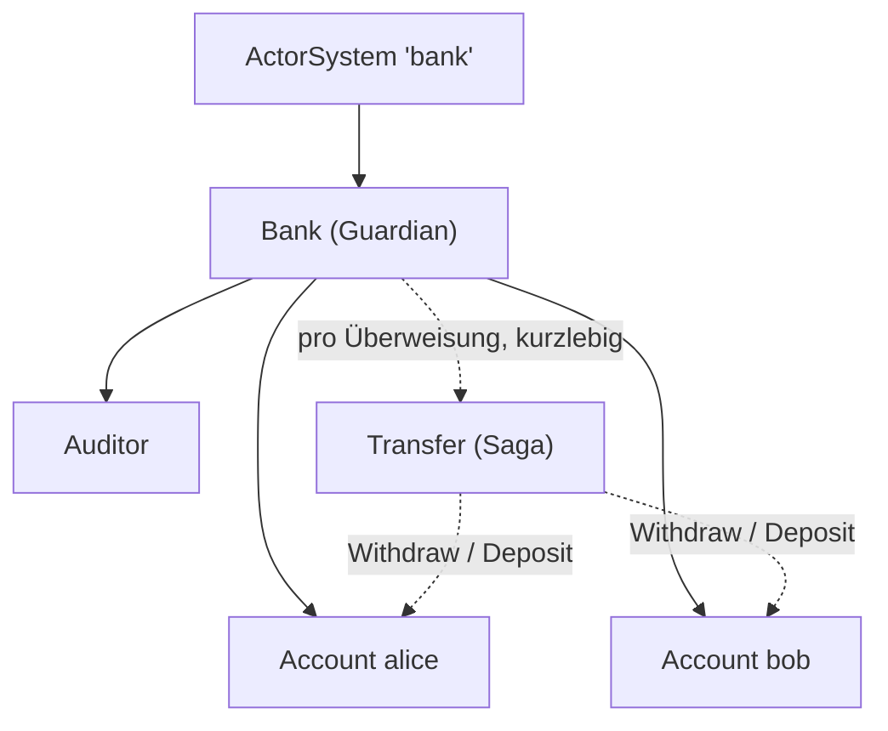
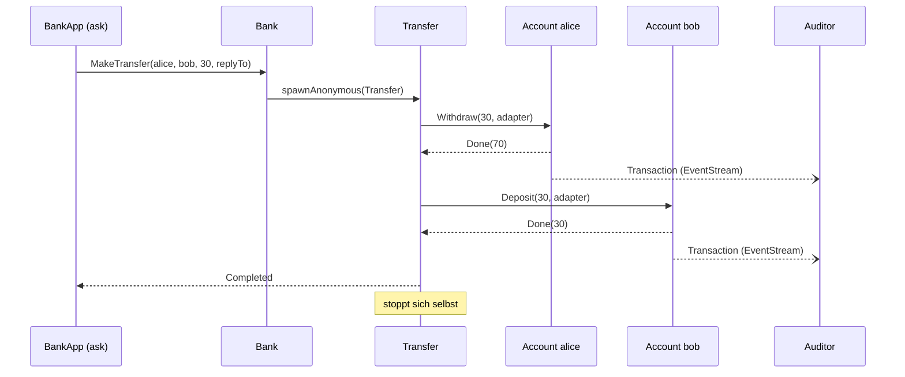
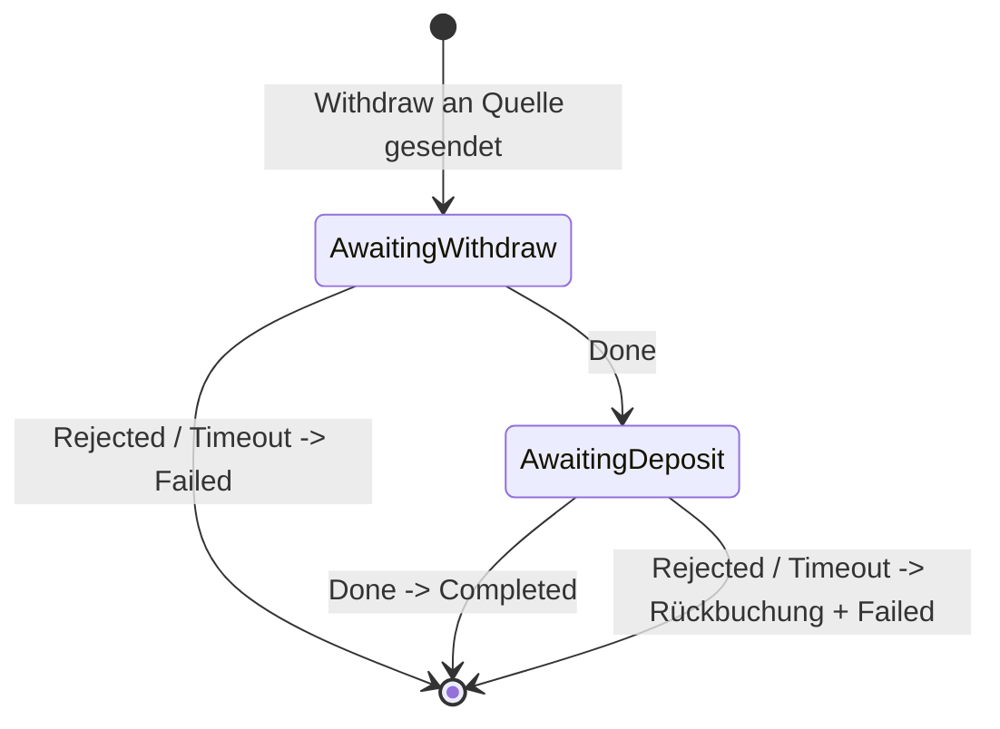

# pekko

Lernmodul für [Apache Pekko](https://pekko.apache.org/) (Fork von Akka 2.6.x) mit **typed Actors**.

| Package | Inhalt |
|---|---|
| `de.wittig.pekko` | Minimales Hello-World (`helloPekko`) |
| `de.wittig.pekko.bank` | Größeres Beispiel: eine kleine Bank aus Actors (`bankApp`) |

```bash
sbt --client "pekko/run"                                    # Hello World (bei mehreren Main-Klassen ggf. Auswahl)
sbt --client "pekko/runMain de.wittig.pekko.bank.bankApp"   # Bank-Beispiel
sbt --client "pekko/test"                                   # Tests
```

## Grundidee

Ein **Actor** hat privaten Zustand und eine Mailbox. Andere Actors sprechen ihn nur über Nachrichten an
(`ref ! message`); es gibt kein gemeinsam genutztes, veränderliches Objekt und somit keine Locks. Ein Actor
verarbeitet immer **eine Nachricht nach der anderen**.

In Pekko Typed ist ein Actor ein `Behavior[T]`: eine Funktion „Nachricht → nächstes Behavior“. Zustand ändert man,
indem man ein neues Behavior mit dem neuen Zustand zurückgibt (hier gibt es deshalb kein `var`).

## Das Bank-Beispiel

### Actor-Hierarchie



Die Bank ist der Root-Actor (Guardian) und erzeugt Kind-Actors. Fällt ein Kind aus, entscheidet sein Elternteil bzw.
dessen Supervisor-Strategie, was passiert.

### Nachrichtenfluss einer Überweisung



Schlägt die Einzahlung fehl, bucht `Transfer` den Betrag auf alice zurück und meldet `Failed`.

### Zustandsautomat von `Transfer`



### Die Dateien

| Datei | Rolle |
|---|---|
| `Account.scala` | Ein Konto. Protokoll (`Deposit`, `Withdraw`, `GetBalance`, `Crash`), Antworten (`Done`, `Rejected`) und das Event `Transaction`. |
| `Bank.scala` | Eröffnet Konten (Kind-Actors), hält sie in einer `Map` und leitet Nachrichten weiter. |
| `Transfer.scala` | Kurzlebiger Actor pro Überweisung (Saga-Muster). |
| `Auditor.scala` | Abonniert den EventStream, protokolliert Transaktionen und gibt per Timer Zwischenstände aus. |
| `BankApp.scala` | `@main`: spielt ein Szenario von außerhalb des Actor-Systems ab. |
| `BankTest.scala` | Tests mit `ActorTestKit` und MUnit. |

## Konzepte und wo man sie findet

| Konzept | Beschreibung | Fundstelle |
|---|---|---|
| **Protokoll als ADT** | Alle erlaubten Nachrichten sind ein `sealed trait`; der Compiler prüft Vollständigkeit. | `Account.Command` |
| **Zustand im Behavior** | Neue Nachricht -> neues Behavior mit neuem Zustand. | `Account.active` |
| **`replyTo`** | Der Absender schickt seine `ActorRef` mit, die Antwort geht dorthin. | `Deposit(amount, replyTo)` |
| **Kind-Actors** | `ctx.spawn` / `spawnAnonymous`; Lebenszyklus gehört dem Elternteil. | `Bank` |
| **Supervision** | `supervise(...).onFailure[...](restart)`: bei Exception wird neu gestartet, der Zustand ist danach wieder der Anfangszustand. | `Account.apply`, `Crash` |
| **EventStream (Pub/Sub)** | `Publish` / `Subscribe` entkoppelt Sender und Empfänger. | `Account.publish`, `Auditor` |
| **`messageAdapter`** | Übersetzt fremde Antworttypen in das eigene Protokoll. | `Auditor`, `Transfer` |
| **Timer** | `withTimers` / `startTimerWithFixedDelay` für periodische Nachrichten. | `Auditor` |
| **Receive-Timeout** | `ctx.setReceiveTimeout` bricht ab, wenn keine Antwort kommt. | `Transfer` |
| **Ask-Pattern** | Von außerhalb des Systems: Request/Response als `Future`. | `BankApp` |
| **Testen** | `TestProbe` fängt Antworten ab und prüft sie. | `BankTest` |

## Typische Stolpersteine

- **Nie** blockierende Aufrufe (`Await`, `Thread.sleep`) innerhalb eines Actors. `Await` steht hier nur in `BankApp`
  außerhalb des Systems.
- Nachrichten müssen **unveränderlich** sein (`case class`), da sie von mehreren Threads gelesen werden.
- Nachrichten von *einem* Sender an *einen* Empfänger behalten ihre Reihenfolge, über mehrere Sender hinweg gibt es
  keine Garantie.
- Nach einem **Restart** ist der Zustand weg. Für dauerhaften Zustand braucht man Pekko Persistence (Event Sourcing).
- Zustellung ist „at most once“: eine Nachricht kann verloren gehen, deshalb Timeouts und Fehlerpfade einplanen.

## Ausgabe von `bankApp` (gekürzt)

```
Einzahlung alice: Done(100)
Abhebung bob (leer): Rejected(Abhebung von 50 nicht moeglich (Stand: 0))
[Audit] alice: Einzahlung 100 -> Stand 100
[Audit] alice: Abhebung 30 -> Stand 70
[Audit] bob: Einzahlung 30 -> Stand 30
Ueberweisung 30: Completed
Ueberweisung 500: Failed(Abhebung fehlgeschlagen: ...)
Staende: alice=Done(70), bob=Done(30)
(Stacktrace: Konto bob ist abgestuerzt -> Supervisor startet neu)
bob nach Absturz (Neustart, Stand zurueckgesetzt): Done(0)
```

## Weiterführend

- [Pekko Typed Dokumentation](https://pekko.apache.org/docs/pekko/current/typed/index.html)
- Nächste Schritte: Pekko Persistence (Event Sourcing), Cluster, Streams, HTTP.
